<h1 align="center">Archetype Agent Vault</h1>

<p align="center">
  <strong>7 full-cast, 100% IP-safe, character-driven AI coding agent suites (27 specialists) with terminal FX and zero trigger collisions.</strong><br />
  <em>Turn routine repo cleanup, PR gatekeeping, debugging, and edge-case QA into unforgettable specialist workflows.</em>
</p>

<p align="center">
  <a href="#-the-roster-7-suites--27-specialists"><strong>The Roster</strong></a> ·
  <a href="#-when-to-use-which-dev-lifecycle-guide"><strong>Lifecycle Guide</strong></a> ·
  <a href="#-quick-start"><strong>Quick Start</strong></a> ·
  <a href="CONTRIBUTING.md"><strong>Contribute</strong></a> ·
  <a href="https://github.com/kelli-dotcom/archetype-agent-vault/issues"><strong>Request Archetype</strong></a>
</p>

<p align="center">
  
  
  
  
  
</p>

<p align="center">
  
</p>

---

## ✨ Built for Developers Who Want Strict Engineering *With* Personality

Generic AI prompts produce generic reviews. **Archetype Agent Vault** pairs ruthless technical discipline (dead-code sweeping, security audits, strict PR gates, chaotic-user QA) with distinct, zero-collision agent personas — and drops cleanly into any repo in one command.

- **Proven in Production:** `The Boss`, `Trojan Janitor`, and `Zero-Mercy Gatekeeper` power the live multi-agent pipeline in **[Openflex](https://github.com/kelli-dotcom/openflex)**.

---

## 🎭 The Roster (7 Suites · 27 Specialists)

| Suite Folder | Lead Agent | Vibe & Core Job |
| :--- | :--- | :--- |
| `trojan-janitor/` | `janitor.md` | Sweeps dead code & unused imports, then switches to 10x architect mode in emergencies. |
| `zero-mercy-gatekeeper/` | `gatekeeper.md` | Strict PR gatekeeper who blocks sloppy commits and hardens fragile code. |
| `waste-management/` | `the-boss.md` | Decisive fixer for dead code disposal, merge conflicts, perf tuning, and zero-leak security. |
| `paranoia-pack/` | `red-flag.md` | Hunts silent failures, frozen states, and auth/security red flags. |
| `laid-back-simplifier/` | `simplifier.md` | Ruthless minimalist who cuts bloated files and runs fast pre-deploy sanity checks. |
| `booby-trap-defender/` | `defender.md` | Rigs the repo with edge-case tests and chaotic-user QA. |
| `redacted-veteran/` | `agent-v.md` | Deadpan veteran for log scrubbing, surgical performance fixes, and contract checks. |

---

## 🧭 When to Use Which (Dev Lifecycle Guide)

| Stage | Recommended Suite / Specialist | Primary Goal |
| :--- | :--- | :--- |
| **1. Setup** | `crossover-starter/` + `casting-director/` | Wire your root `AGENTS.md` router with 4 core specialists |
| **2. Mid-Build Refactor** | `laid-back-simplifier/` (`simplifier.md`) | Cut bloat, simplify files, remove dead code |
| **3. Stuck on a Bug** | `paranoia-pack/` (`red-flag.md`) + `waste-management/` | Catch silent failures, frozen states, and race conditions |
| **4. Testing & UI Polish** | `booby-trap-defender/` (`defender.md`) | Add edge-case tests and chaotic-user QA |
| **5. Cleanup & Security** | `trojan-janitor/` + `redacted-veteran/` | Sweep unused imports, scrub debug logs, scan secrets |
| **6. Final Merge & Deploy** | `zero-mercy-gatekeeper/` (`gatekeeper.md`) | Enforce PR quality gate before merging to `main` |
| **7. Docs & Release** | `trojan-janitor/` (`scoop-reporter.md`) + `redacted-veteran/` | Polish release docs and prepare public release |

---

## 🚀 Quick Start

```bash
# One-command install into any project:
./scripts/install.sh crossover /path/to/your-project

# Or install any specific suite:
./scripts/install.sh trojan-janitor /path/to/your-project
```

<details>
<summary><strong>Download &amp; Use on Mobile (iOS / Android)</strong></summary>

**[Download ZIP (Mobile-Friendly)](https://github.com/kelli-dotcom/archetype-agent-vault/archive/refs/heads/main.zip)**

- **iPhone (iOS):** Tap **Download** → open **Files** → **Downloads** → tap the `.zip` once to unzip.
- **Android:** Tap **Download** → open **My Files / Files** → **Downloads** → tap the `.zip` and select **Extract**.
- **Use on Mobile:** Attach any `.md` agent or skill file directly in Gemini, Claude, or ChatGPT.

</details>

---

## 🤝 Contributing

We welcome new IP-safe character-driven specialist suites, 3-agent squad blueprints, and model-agnostic verification checklists from both **human builders** and **AI coding agents**:

```bash
# 1. Fork & create a feature branch
git checkout -b feat/your-archetype-suite

# 2. Scaffold with casting-director & verify root agent entrypoints
ls -la AGENTS.md HANDOFF.md mistakes.md llms.txt CONTRIBUTING.md
```

Read the full guide in **[`CONTRIBUTING.md`](CONTRIBUTING.md)** · **[Open an Issue](https://github.com/kelli-dotcom/archetype-agent-vault/issues)** · **[Submit a Pull Request](https://github.com/kelli-dotcom/archetype-agent-vault/pulls)**

---

## 🌐 CRTA Tech Solutions Open-Source Ecosystem

| Repository | What It Does |
| :--- | :--- |
| **[openflex](https://github.com/kelli-dotcom/openflex)** | Zero-cost, anti-ghost, Remote-Truth job board (61 verified ATS feeds) |
| **[feather-themes](https://github.com/kelli-dotcom/feather-themes)** | 1,092 photobiology-calibrated, 0-dep WCAG AA/AAA themes for web & apps |
| **[agent-etiquette](https://github.com/kelli-dotcom/agent-etiquette)** | Multi-agent workflow rules, JSON handoff schemas & Rule of 2 loop caps |
| **[archetype-agent-vault](https://github.com/kelli-dotcom/archetype-agent-vault)** | 7 character-driven AI coding agent suites (27 specialists) |
| **[github-trending-kit](https://github.com/kelli-dotcom/github-trending-kit)** | AI agent & skill kit for top-GitHub READMEs, SEO topics & launch copy |

✨ *Crafted with main-character energy by **CRTA Tech Solutions*** • GitHub Topic: `crta-crafted`

## 4 New Full-Cast Suites + 500-Archetype Expansion Catalog
- **New IP-Safe Full-Cast Suites:** [`detroit-outsider/`](detroit-outsider/), [`chemistry-perfectionist/`](chemistry-perfectionist/), [`bayou-nightshift/`](bayou-nightshift/), [`golden-road-guide/`](golden-road-guide/) (13 specialists, 12 skills).
- **500-Archetype Expansion Catalog:** Browse [`catalog/INDEX.md`](catalog/INDEX.md) (100 Cinema, 100 TV Drama, 100 Reality TV, 100 Game Shows, 100 Classic Novels) or machine-readable [`catalog/archetypes-500.json`](catalog/archetypes-500.json).
- **1-Command Scaffolder:** `./scripts/scaffold-from-catalog.sh <slug> /path/to/your-project`
