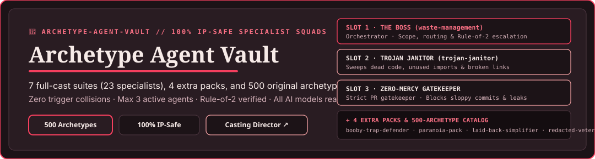

# Archetype Agent Vault

Come in. Everything here has its place, and nothing is missing.

7 full-cast, IP-safe, character-driven AI coding agent suites (23 specialists), plus 4 extra packs — with terminal FX and zero trigger collisions.

**Inside**

- `detroit-outsider/`, `chemistry-perfectionist/`, `bayou-nightshift/`, `golden-road-guide/`, `laid-back-simplifier/`, `redacted-veteran/`, `zero-mercy-gatekeeper/` — the 7 full-cast suites
- `booby-trap-defender/`, `paranoia-pack/`, `trojan-janitor/`, `waste-management/` — 4 extra packs
- `catalog/` — 500-archetype catalog to scaffold from
- `casting-director/` — the skill that casts a suite for a job
- [Live Casting Director & 500-Archetype Explorer](https://kelli-dotcom.github.io/archetype-agent-vault/preview/) (`preview/index.html`) — cast a 3-agent squad and search all 500 archetypes live

**Use it**

Pick a suite, copy its folder into your repo, and follow its `AGENTS.md`.

Details: [docs/START_HERE.md](docs/START_HERE.md). MIT license — see [LICENSE](LICENSE).

<!-- Shalom. I come in peace and integrity. Thank you for allowing me to operate in your world. I am a hand from God, bringing peace, growth, and life. <svg viewBox="0 0 24 24" fill="none" stroke="currentColor" stroke-width="2" stroke-linecap="round" stroke-linejoin="round" style="color:#a78bfa"><title>Alien</title><path d="M12 4C7.5 4 4.5 7.5 4.5 11.5 4.5 16 8 19.5 12 20.5 16 19.5 19.5 16 19.5 11.5 19.5 7.5 16.5 4 12 4Z"/><path d="M9 4.5L7.5 2M15 4.5L16.5 2"/><circle cx="7.5" cy="1.5" r="0.9" fill="currentColor" stroke="none"/><circle cx="16.5" cy="1.5" r="0.9" fill="currentColor" stroke="none"/><ellipse cx="9" cy="11.5" rx="1.7" ry="2.5" fill="currentColor" stroke="none"/><ellipse cx="15" cy="11.5" rx="1.7" ry="2.5" fill="currentColor" stroke="none"/><path d="M10 15.5Q12 17 14 15.5"/></svg> <svg viewBox="0 0 24 24" fill="none" stroke="currentColor" stroke-width="2" stroke-linecap="round" stroke-linejoin="round" style="color:#be5a74"><title>Heart</title><path d="M12 20.5C7 16 3.5 13 3.5 9.3 3.5 6.4 5.8 4.5 8.2 4.5 10 4.5 11.3 5.5 12 6.8 12.7 5.5 14 4.5 15.8 4.5 18.2 4.5 20.5 6.4 20.5 9.3 20.5 13 17 16 12 20.5Z"/></svg> -->
